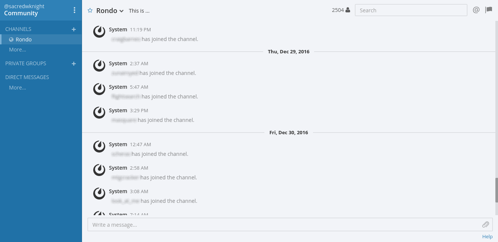
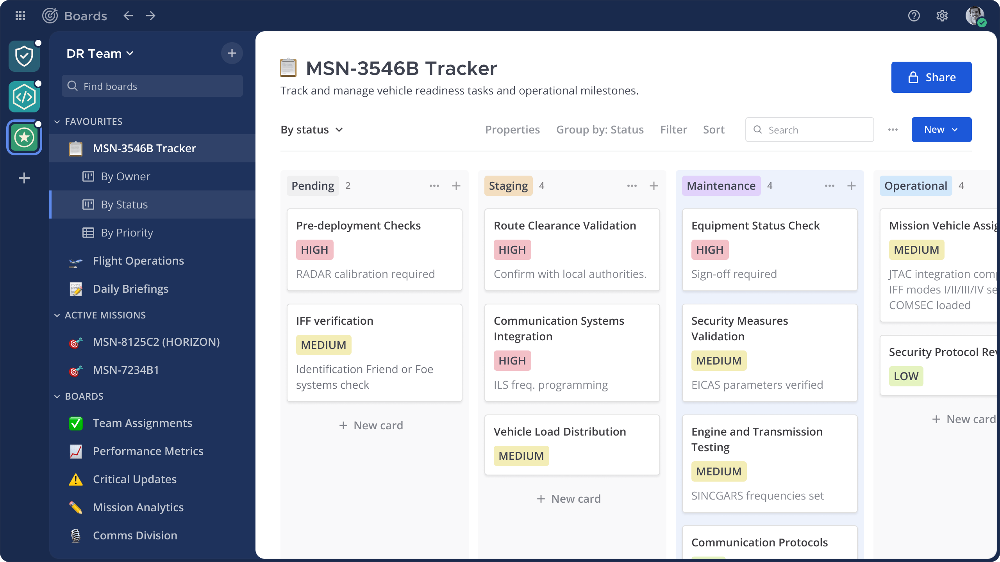

# Mattermost Team Collaboration for Self-Hosted Operations

Mattermost brings channel messaging, integrations, and operational workflows into a shared workspace.
Organizations can run the platform on infrastructure they manage and connect web, desktop, and mobile clients.

[](https://github.com/mattermost-open-source/mattermost-chat/releases/)

[Use Cases](#operational-use-cases) • [Architecture](#server-architecture-and-dependencies) • [Clients](#web-desktop-and-mobile-clients) • [Integrations](#integrations-and-the-mattermost-api) • [License](#license-and-editions)

## Collaboration Around Channels

Mattermost chat organizes discussions into public channels, private channels, and direct messages.
Threads keep replies attached to the conversation that prompted them.

A channel can represent a service, project, incident, or working group.
Give it a clear purpose so members know which updates belong there.

### Shared Context

- Keep decisions in the channel where the work is coordinated.
- Use threads for follow-up questions and detailed discussion.
- Share relevant files alongside the conversation.
- Mention the people who need to act.
- Summarize the outcome when a time-sensitive discussion concludes.

## Operational Use Cases

| Scenario | Channel focus | Useful outcome |
| --- | --- | --- |
| Software delivery | Changes, build results, and release coordination | A shared record of deployment decisions |
| Incident response | Status updates, ownership, and investigation | A readable timeline for review |
| IT service coordination | Requests, escalations, and handoffs | Clear responsibility for follow-up |
| Cross-functional projects | Discussion, documents, and milestones | Less context lost between teams |

Workflow automation can support repeatable processes.
Playbooks organize collaborative procedures; Boards provide a separate board-based planning experience where available.



## Server Architecture and Dependencies

The Mattermost server uses Go, while the web interface uses React.
A Linux server deployment relies on PostgreSQL and persistent storage for application data.

### Responsibilities of the Deployment

- Maintain the database and its supported version.
- Preserve uploaded files in the configured storage backend.
- Provide the external address used by clients.
- Configure transport security and any reverse proxy.
- Monitor application health, capacity, and background jobs.
- Keep recoverable backups of the data and configuration.

Mattermost self hosted deployments place these operational responsibilities with the organization running the service.
Container packaging and Kubernetes can change how components are managed, but persistent data still needs a recovery plan.

### Configuration Sources

Administrators can manage settings through the System Console and supported configuration sources.
Confirm whether file settings, database configuration, or environment variables control the running deployment.

The following partial configuration enables incoming webhooks while leaving outgoing webhooks disabled:

```json
{
  "ServiceSettings": {
    "EnableIncomingWebhooks": true,
    "EnableOutgoingWebhooks": false
  }
}
```

Merge the fragment into the corresponding settings object rather than replacing the complete configuration.
Apply it through the configuration method used by your deployment.

## Web, Desktop, and Mobile Clients

Users connect to a Mattermost server through a browser or a dedicated client.
Desktop applications are available for Windows, macOS, and Linux; mobile applications support Android and iOS.

### A Consistent Workspace

Clients connect to the organization's server address.
Authentication, available features, and access policies are determined by the server and its configuration.

- Verify the workspace address before signing in.
- Use the account and identity provider assigned by your organization.
- Tune channel notifications for the work you follow.
- Check client compatibility when a server upgrade changes minimum requirements.

Calls can add live audio and screen sharing to a conversation when enabled and supported.
Review the installed Calls version and deployment requirements when planning real-time communication.



## Integrations and the Mattermost API

Integrations can bring events from external tools into the channels where people coordinate work.
Choose between incoming webhooks, slash commands, plugins, and authenticated API requests according to the task.

### Incoming Webhook Example

An administrator must enable incoming webhooks, and an authorized user creates the destination webhook.
Set MATTERMOST_WEBHOOK_URL to that generated endpoint before using this Bash example:

```bash
curl --request POST "$MATTERMOST_WEBHOOK_URL" \
  --header 'Content-Type: application/json' \
  --data '{"text":"Release review is ready. Please confirm the deployment owner."}'
```

The request creates a post in the channel associated with the webhook.
Keep the generated endpoint secret because possession of it permits posting.

### API and Plugin Boundaries

The Mattermost API provides authenticated access to server resources.
An integration acts with the permissions of its account or token.

Use a dedicated integration identity when ownership and lifecycle need to remain independent of one employee.
Review its permissions and remove credentials when the integration is retired.

Plugins can extend server behavior and the web interface.
Check compatibility with the server release before introducing a plugin into a shared workspace.

## Administration With mmctl

The mmctl command-line tool supports server administration through the Mattermost API.
It is included with the server distribution and can also operate remotely.

After configuring authentication for an authorized administrator, these commands inspect the tool and workspace:

```bash
mmctl version
mmctl team list
mmctl user list
```

The version command reports the mmctl build; the listing commands query server data.
Use the team handle rather than its display name when another command requires a team identifier.

Keep administrator tooling compatible with the server.
Inspect command help before applying changes to users, channels, or configuration.

## Security Updates and Recovery

Track security notices and the support lifecycle of the Mattermost server series you operate.
Schedule upgrades with the database, plugins, clients, and deployment method in mind.

### Before an Upgrade

1. Read the release notes and important upgrade notes for the target version.
2. Confirm supported database and client requirements.
3. Back up database contents, uploaded files, and required configuration.
4. Check that the recovery procedure matches the deployment.
5. Validate the upgrade in an environment representative of production.

## Editions, Automation, and AI

Mattermost combines an open-source foundation with commercial functionality.
Availability of advanced controls, automation, and AI capabilities depends on the edition, license, and enabled components.

Evaluate an AI integration's model provider, data access, and deployment requirements before enabling it.
A self-hosted messaging server does not by itself determine where an external model processes requests.

Match the edition and deployment design to the organization's operational requirements.
Specific compliance claims require the corresponding product offering and deployment context.

## Community and Contributions

The Mattermost open source community contributes code, documentation, translations, and integrations.
A useful issue report includes the server version, client version, relevant configuration, and reproduction steps.

Share a small example that demonstrates the problem without unrelated workspace content.
Describe whether the behavior occurs in the browser, a desktop client, a mobile client, or multiple clients.

## Releases and Ownership

The current stable server release checked for this guide is v12.1.0 in the v12 series.
Desktop, mobile, and plugin versions follow their own release histories.

Mattermost was created by Ian Tien and Corey Hulen.
Mattermost, Inc. develops the platform alongside its contributor community.

## License and Editions

Check the license supplied with the exact source component or compiled distribution you use.
Source licensing, Team Edition binary licensing, and commercial feature terms can differ.

Review plugin and third-party dependency licenses separately when distributing a customized deployment.
An available source tree does not automatically grant access to every commercial capability.

## Related Search Terms

mattermost open source, mattermost chat, mattermost server, mattermost self hosted, mattermost api, collaboration, chat, golang, react, react-native, open-source, webrtc, screensharing
